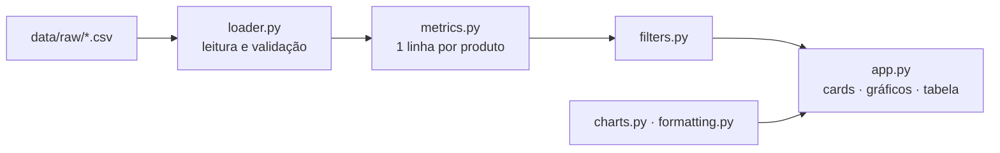

# 🌿 Garden Shop — Dashboard de Estoque e Reposição

[](https://garden-shop-dashboard-cnddk2u89vfajvgsmsadkz.streamlit.app/)


**Autora:** Ana Santos · **Dashboard online:** [garden-shop-dashboard.streamlit.app](https://garden-shop-dashboard-cnddk2u89vfajvgsmsadkz.streamlit.app/)

> 🎓 Projeto desenvolvido no curso de **pós-graduação da [ASN.Rocks](https://asn.rocks)**: Lista 2 da disciplina **IA Generativa na Prática**.

Dashboard de página única para a gestão de estoque de uma loja virtual de jardinagem. Em uma tela, ele responde: **o que está em risco, quanto vale o estoque, o que vende mais e o que precisa ser comprado de qual fornecedor.**


---

## Sumário

- [O problema](#o-problema)
- [O que o dashboard mostra](#o-que-o-dashboard-mostra)
- [Regras de negócio](#regras-de-negócio)
- [Como executar](#como-executar)
- [Arquitetura](#arquitetura)
- [Testes](#testes)
- [Processo de desenvolvimento](#processo-de-desenvolvimento)
- [Dados e limitações](#dados-e-limitações)
- [Contexto acadêmico](#contexto-acadêmico)
- [Documentação](#documentação)

---

## O problema

Em uma loja virtual, produto sem estoque é venda perdida. A equipe da Garden Shop não tinha uma visão consolidada: para saber o que repor, precisava cruzar à mão o saldo de cada produto com o nível de reposição, as vendas e o fornecedor.

## O que o dashboard mostra

| Bloco | Conteúdo | Pergunta que responde |
| --- | --- | --- |
| **Filtros** | Período de vendas, categoria, fornecedor, status e curva ABC | — |
| **6 cards** | Valor do estoque a custo · valor potencial de venda · margem bruta · produtos em ruptura · abaixo do ponto de reposição · déficit de peças | Quanto vale o estoque e quantos produtos estão em risco? |
| **Barras empilhadas** | Produtos por categoria e status de estoque | Onde estão os problemas? |
| **Treemap** | Valor a custo por categoria e produto, colorido pelo status | Onde está o capital parado? |
| **Quadrante de prioridade** | Vendas efetivas × dias de cobertura, com linhas nas medianas | O que vende muito e está acabando? |
| **Tabela de compras** | Produto, fornecedor, e-mail, sugestão mínima de compra, cobertura, ABC e status; exportável em CSV | O que comprar e de quem? |

**Valores de referência (base completa, sem filtros):** US$ 4.763,00 a custo · US$ 10.389,25 de venda · margem de 54,2% · 1 produto em ruptura · 5 abaixo do ponto de reposição · déficit de 60 peças.

## Regras de negócio

| Regra | Definição |
| --- | --- |
| **Venda efetiva** | Pedidos `shipped`, `pending` e `processing`. Pedidos `cancelled` não contam. |
| **Status do estoque** | A primeira condição verdadeira, nesta ordem: Descontinuado → Ruptura (0) → Reposição urgente (≤ nível de reposição) → Alerta limítrofe (≤ 1,25 × nível) → Saudável. |
| **Recomendação de compra** | Déficit mínimo para voltar ao nível de reposição, só para produtos ativos. Descontinuados nunca recebem sugestão. |
| **Cobertura** | Estoque atual ÷ venda média diária do período. Estoque com venda zero = "Sem giro". |
| **Curva ABC** | Pela receita do período; o produto que cruza 80% (ou 95%) fica na classe superior. Sem receita = "Sem vendas". |
| **Período × estoque** | O filtro de período muda só os indicadores de venda; o estoque é sempre a posição atual. |
| **Sem duplicação** | As vendas são agregadas por produto **antes** de juntar com o cadastro, para não repetir saldos. |

Fórmulas, exemplos e casos de borda: [`SPEC.md`](SPEC.md), seções 6 e 9.

## Como executar

Pré-requisito: Python 3.12 ou superior.

```powershell
# Windows (PowerShell), na pasta do projeto
python -m venv .venv
.\.venv\Scripts\Activate.ps1
python -m pip install -r requirements.txt

python -m pytest                 # 81 testes
python -m streamlit run app.py   # abre em http://localhost:8501
```

> Se aparecer `No module named ...`, o ambiente virtual não está ativado: a linha do terminal precisa começar com `(.venv)`.

## Arquitetura

As regras ficam em funções puras, separadas da interface. O `app.py` não tem nenhuma fórmula.



```
├── app.py                    # interface Streamlit (página única)
├── .streamlit/config.toml    # tema, paleta sem vermelho
├── data/raw/                 # 5 CSVs, somente leitura
├── src/garden_shop/
│   ├── config.py             # constantes de negócio e paleta
│   ├── loader.py             # leitura e validação
│   ├── metrics.py            # regras de cálculo
│   ├── filters.py            # filtros
│   ├── charts.py             # gráficos Plotly
│   └── formatting.py         # US$, %, dias
└── tests/                    # 81 testes (pytest)
```

## Testes

Os testes foram escritos **antes** do código de cada fase, a partir dos exemplos com resultado esperado da SPEC.

| Arquivo | Cobre |
| --- | --- |
| `test_loader.py` | Carga, colunas ausentes, valores fora do domínio, formatos de data, itens órfãos |
| `test_metrics.py` | Cancelados, status, cards, cobertura, curva ABC, tabela de compras, prevenção de duplicação |
| `test_filters.py` | Filtros combinados e filtro sem resultados |
| `test_charts.py` | Regra do quadrante e totais dos gráficos |
| `test_palette.py` | Nenhuma cor vermelha na paleta |
| `test_formatting.py` | Formatação de US$, % e dias |
| `test_app.py` | A página abre e mostra os estados vazios corretamente |

Um recorte de 4 produtos com valores calculados à mão (SPEC, seção 13) valida os indicadores. Por exemplo, juntar produtos e itens diretamente daria US$ 1.404,00 de estoque em vez de US$ 482,00, e um teste garante que isso não acontece.

## Processo de desenvolvimento

Desenvolvido com IA generativa como par, seguindo **SDD (Spec-Driven Development)**: PRD → SPEC → testes → código, com a SPEC atualizada a cada descoberta (versões 1.0 a 1.7).

| Fase | PR | Entrega |
| --- | --- | --- |
| 0 | — | PRD, SPEC e AGENTS |
| 1 | [#1](https://github.com/by-anasantos/garden-shop-dashboard/pull/1) | Carga e validação dos dados |
| 2 | [#2](https://github.com/by-anasantos/garden-shop-dashboard/pull/2) | Regras de cálculo e filtros |
| 3 | [#3](https://github.com/by-anasantos/garden-shop-dashboard/pull/3) | Dashboard Streamlit |
| 4 | [#4](https://github.com/by-anasantos/garden-shop-dashboard/pull/4) | Fechamento da documentação |
| 5 | [#5](https://github.com/by-anasantos/garden-shop-dashboard/pull/5) | Publicação no Streamlit Community Cloud |

## Dados e limitações

`data/raw/` contém cópias fiéis de 5 CSVs da Garden Shop (products, categories, suppliers, orders e order_items), com 24 produtos e 24 pedidos de 15/01/2024 a 14/06/2024. O `customers.csv` **não é usado nem versionado**, porque contém dados pessoais e não entra nos indicadores.

**Limitações:** não há prazo de entrega dos fornecedores, histórico de movimentações do estoque nem lote mínimo de compra, e a janela de vendas é curta (cerca de 5 meses, com sazonalidade). Por isso, a cobertura serve para comparar produtos entre si, não como previsão.

## Contexto acadêmico

Este projeto é a entrega da **Lista 2 da disciplina IA Generativa na Prática**, do curso de pós-graduação da **[ASN.Rocks](https://asn.rocks)**. Ele dá continuidade à proposta de dashboard elaborada na Lista 1. O exercício pedia:

- documentar a solução em **PRD.md**, **SPEC.md** e **AGENTS.md**;
- implementar uma versão funcional com indicadores, filtros e visualizações;
- trabalhar em **branches e PRs** no GitHub, com a SPEC como referência viva;
- escrever os **testes das regras de cálculo antes da implementação**;
- usar a IA generativa como par: orientar, questionar as propostas e revisar as alterações.

## Documentação

| Documento | Conteúdo |
| --- | --- |
| [`PRD.md`](PRD.md) | Problema, usuários, escopo, requisitos e decisões |
| [`SPEC.md`](SPEC.md) | Fórmulas, contratos de dados, exemplos com resultado esperado e casos de teste |
| [`AGENTS.md`](AGENTS.md) | Como agentes de IA trabalham no repositório; comandos verificados |
| [`CLAUDE.md`](CLAUDE.md) | Orientações específicas para o Claude Code |

---

**Stack:** Python · Streamlit · Pandas · Plotly · Pytest · **Curso:** Pós-graduação ASN.Rocks · IA Generativa na Prática · **Autora:** Ana Santos
