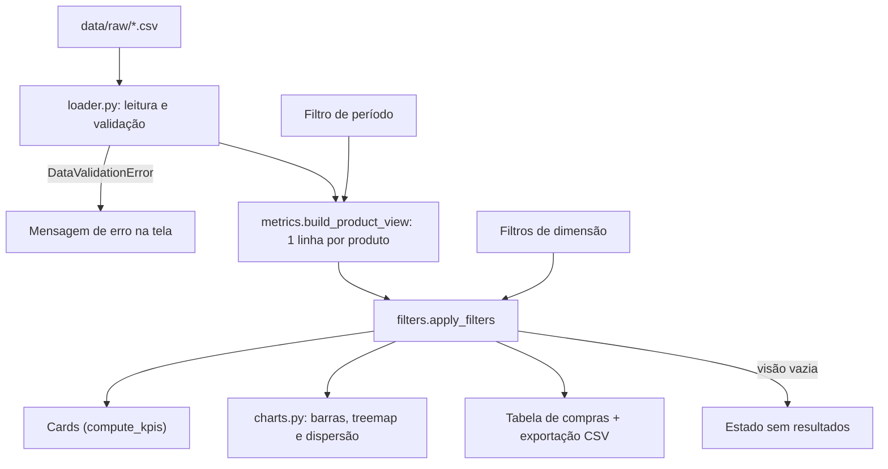

# SPEC — Dashboard de Estoque e Reposição da Garden Shop

> **Objetivo:** transformar os requisitos do [`PRD.md`](PRD.md) em uma especificação verificável, que oriente o planejamento, a implementação e a validação do dashboard.
>
> **Documento de referência do SDD:** esta especificação é a fonte de verdade para o comportamento aprovado. Toda mudança de regra deve ser registrada aqui antes de chegar ao código (seção 17).

## 1. Metadados

- **Projeto:** Garden Shop — Dashboard de Estoque e Reposição
- **Autora e responsável pela aprovação:** Ana Santos
- **Versão da especificação:** 1.4
- **Status:** Approved
- **PRD relacionado:** [`PRD.md`](PRD.md) (versão 1.1)
- **Data:** 2026-10-26

### Status permitidos

- `Draft`: em elaboração.
- `In Review`: em revisão.
- `Approved`: aprovado para implementação.
- `Implemented`: implementado, aguardando validação final.
- `Verified`: implementação validada contra os critérios definidos.
- `Deprecated`: substituído ou descontinuado.

## 2. Objetivo técnico

Construir um dashboard em **Streamlit**, de página única, que lê cinco CSVs da Garden Shop, calcula uma visão consolidada **com uma linha por produto** (estoque atual, vendas efetivas no período, status, cobertura e curva ABC) e exibe cards, três gráficos Plotly e uma tabela de compras exportável.

As regras de cálculo ficam em funções Python puras, independentes da interface e cobertas por testes Pytest escritos a partir dos exemplos desta SPEC.

## 3. Referências e rastreabilidade

| Requisito do PRD | Requisito da SPEC | Regras | Critérios de validação |
| --- | --- | --- | --- |
| RF-001 | REQ-001 | — | TEST-001 a TEST-005 |
| RF-002 | REQ-002 | RN-001, RN-002 | TEST-010, TEST-011, TEST-012 |
| RF-003 | REQ-003 | RN-003 | TEST-013 |
| RF-004, RF-005 | REQ-004 | RN-004, RN-005, RN-006 | TEST-014, TEST-015, TEST-021 |
| RF-006 | REQ-005 | RN-008 | TEST-016 |
| RF-007 | REQ-006 | RN-007 | TEST-017 |
| RF-008 | REQ-007 | RN-002 | TEST-012, TEST-019 |
| RF-009, RF-010, RF-011 | REQ-008 | — | TEST-022, TEST-030 |
| RF-012 | REQ-009 | RN-004, RN-005, RN-009 | TEST-018, TEST-030 |
| RF-013 | REQ-010 | — | TEST-019, TEST-020 |
| RF-014 | REQ-011 | — | TEST-030 |
| RNF-001 | REQ-012 | — | TEST-023, TEST-030 |
| RF-015 (Could) | — | — | Fora do plano inicial (seção 12) |

## 4. Escopo técnico

### 4.1. Incluído

- Leitura e validação de `products`, `categories`, `suppliers`, `orders` e `order_items`.
- Construção da visão por produto e cálculo dos indicadores.
- Filtros de categoria, fornecedor, status, curva ABC e período de vendas.
- Seis cards, barras empilhadas, treemap, dispersão e tabela de compras exportável.
- Tema visual sem vermelho.
- Testes automatizados das regras de carga e de cálculo.

### 4.2. Excluído

- Leitura de `customers.csv`.
- Gravação em qualquer arquivo de dados.
- Previsão de demanda, lead time, MOQ, autenticação e envio de e-mails.
- Filtro da tabela por clique nos gráficos (RF-015, Could).
- Publicação no Streamlit Community Cloud (prevista para depois da entrega — PRD, DP-003).

## 5. Arquitetura proposta

### 5.1. Visão geral

A solução separa a **carga**, as **regras** e a **apresentação**. A interface (`app.py`) não contém fórmulas: apenas chama as funções de `src/garden_shop/` e organiza o resultado na tela.

### 5.2. Componentes

| Componente | Responsabilidade | Entradas | Saídas |
| --- | --- | --- | --- |
| `src/garden_shop/config.py` | Caminho dos dados, constantes de negócio (fator 1,25; limites ABC 0,80 e 0,95), rótulos e ordem dos status, paleta. | Variável `GARDEN_SHOP_DATA_DIR` (opcional) | Constantes |
| `src/garden_shop/loader.py` | Ler os CSVs, validar colunas, tipos, domínios e chaves; normalizar datas e booleanos. | Pasta de dados | `GardenShopData` (DataFrames + lista de avisos) ou `DataValidationError` |
| `src/garden_shop/metrics.py` | Vendas efetivas, status, cobertura, curva ABC, visão por produto, cards e tabela de compras. | `GardenShopData`, período | `product_view` (DataFrame) e dicionário de KPIs |
| `src/garden_shop/filters.py` | Aplicar os filtros de dimensão sobre a visão por produto. | `product_view`, seleção | `product_view` filtrada |
| `src/garden_shop/charts.py` | Construir as figuras Plotly com a paleta. | `product_view` filtrada | Figuras Plotly |
| `src/garden_shop/formatting.py` | Formatar US\$, percentuais, dias e "Sem giro". | Números | Textos |
| `app.py` | Layout de página única, filtros, cache, estados vazios e exportação. | Módulos acima | Tela Streamlit |
| `.streamlit/config.toml` | Tema base (cores e fonte). | — | Tema |
| `tests/` | Testes das regras com o recorte da seção 13 e com a base completa. | Fixtures | Resultado do Pytest |

### 5.3. Fluxo de execução

1. `app.py` chama `load_data()` (em cache com `st.cache_data`), que lê e valida `data/raw/`.
2. Os filtros do topo definem o período (padrão: da menor à maior `order_date`) e as dimensões.
3. `build_product_view(data, start, end)` calcula a visão de **todos** os produtos para o período. A curva ABC é calculada aqui, sobre o catálogo completo.
4. `apply_filters(view, selection)` restringe as linhas por categoria, fornecedor, status e ABC.
5. `compute_kpis`, as funções de `charts.py` e `purchase_table` usam a visão filtrada.
6. Se a visão filtrada estiver vazia, os gráficos e a tabela são substituídos por mensagens (REQ-010).

### 5.4. Diagrama



## 6. Requisitos comportamentais

### REQ-001 — Carga e validação dos dados

- **Origem:** RF-001, RNF-002, RNF-003
- **Descrição:** o sistema deve ler os cinco CSVs necessários, validar sua estrutura e devolver DataFrames tipados, sem alterar os arquivos.
- **Entrada:** pasta definida em `GARDEN_SHOP_DATA_DIR` ou, por padrão, `data/raw/`.
- **Processamento:** validações da seção 7.1. Datas aceitas em `AAAA-MM-DD` ou `DD/MM/AAAA`; booleanos `true/false` sem diferenciar maiúsculas e minúsculas.
- **Saída:** `GardenShopData` com `products`, `categories`, `suppliers`, `orders`, `order_items` e `warnings`.
- **Erros e exceções:**
  - Arquivo ausente, coluna obrigatória ausente, ID duplicado, valor fora do domínio ou data inválida geram `DataValidationError`, com arquivo, coluna e valor.
  - Itens de pedido órfãos (sem pedido ou sem produto) são descartados e registrados em `warnings`.
  - Produto com `category_id` ou `supplier_id` inexistente é mantido e registrado em `warnings`; o rótulo "Não cadastrada" ou "Não cadastrado" é aplicado em `build_product_view` (REQ-002 em diante), não no loader.
  - O loader devolve **somente os campos da seção 7.1**; os campos não utilizados não entram nos DataFrames.
- **Critérios de aceitação:**
  - Dado os CSVs originais, quando a carga é executada, então resultam 24 produtos, 8 categorias, 6 fornecedores, 24 pedidos, 48 itens e nenhum aviso.
  - Dado um `orders.csv` sem a coluna `status`, quando a carga é executada, então ocorre `DataValidationError` citando `orders.csv` e `status`.
  - Dado qualquer execução, então `customers.csv` não é lido.

### REQ-002 — Vendas efetivas por produto no período

- **Origem:** RF-002, RN-001, RN-002
- **Descrição:** o sistema deve somar a quantidade e a receita vendidas por produto, considerando apenas pedidos efetivos com `order_date` dentro do período.
- **Processamento:**
  - `is_valid_sale = status ∈ {shipped, pending, processing}`.
  - Filtrar os pedidos por `start ≤ order_date ≤ end` (datas inclusivas).
  - `qty_sold = Σ quantity` e `revenue = Σ quantity × unit_price` dos itens válidos, **agregados por `product_id` antes** de qualquer junção com produtos (ADR-002).
  - `period_days = (end − start).days + 1`.
- **Saída:** `qty_sold` e `revenue` por produto; produtos sem vendas recebem 0.
- **Critérios de aceitação:**
  - Dado o recorte da seção 13, quando o período é 2024-01-15 a 2024-06-14, então o Pruning Shears (9) tem `qty_sold = 1` e `revenue = 22,00`, pois o pedido 17 está cancelado.
  - Dado o mesmo recorte, quando o período é 2024-03-01 a 2024-06-30, então o Fiddle-Leaf Fig (1) tem `qty_sold = 3`, `period_days = 122` e `quantity_on_hand = 14` (inalterado).

### REQ-003 — Status de estoque

- **Origem:** RF-003, RN-003
- **Descrição:** o sistema deve atribuir a cada produto exatamente um status, pela primeira condição verdadeira:

| Ordem | Status | Condição |
| --- | --- | --- |
| 1 | Descontinuado | `discontinued = true` |
| 2 | Ruptura | `quantity_on_hand = 0` |
| 3 | Reposição urgente | `quantity_on_hand ≤ reorder_level` |
| 4 | Alerta limítrofe | `quantity_on_hand ≤ reorder_level × 1,25` |
| 5 | Saudável | demais casos |

- **Critérios de aceitação:**
  - Dado o Bird Feeder (24): `discontinued = true`, 4 ≤ 6, então o status é **Descontinuado**.
  - Dado `reorder_level = 8`: `quantity_on_hand = 8` → Reposição urgente; `10` → Alerta limítrofe; `11` → Saudável.
  - Dado a base completa, então: 17 Saudável, 4 Reposição urgente (4, 7, 11 e 20), 1 Ruptura (14), 1 Alerta limítrofe (22) e 1 Descontinuado (24).

### REQ-004 — Cards de estoque

- **Origem:** RF-004, RF-005, RN-004, RN-005, RN-006
- **Descrição:** o sistema deve calcular seis indicadores sobre a visão filtrada:

| Card | Fórmula | Produtos considerados |
| --- | --- | --- |
| Valor do estoque (custo) | `Σ quantity_on_hand × cost` | Todos, inclusive descontinuados |
| Valor potencial de venda | `Σ quantity_on_hand × price` | Todos, inclusive descontinuados |
| Margem bruta média em estoque | `(venda − custo) / venda`; "—" se venda = 0 | Todos, inclusive descontinuados |
| Produtos em ruptura | contagem de `quantity_on_hand = 0` | Somente ativos |
| Abaixo do ponto de reposição | contagem de `quantity_on_hand ≤ reorder_level` (inclui as rupturas) | Somente ativos |
| Déficit total de peças | `Σ max(reorder_level − quantity_on_hand, 0)` | Somente ativos |

- **Critérios de aceitação:**
  - Dado a base completa sem filtros, então: US\$ 4.763,00; US\$ 10.389,25; 54,2%; 1; 5; 60.
  - Dado o recorte da seção 13, então: US\$ 482,00; US\$ 912,00; 47,1%; 1; 1; 10.
  - Dado qualquer filtro de período, então os seis cards não mudam.

### REQ-005 — Venda média diária e dias de cobertura

- **Origem:** RF-006, RN-008
- **Processamento:**
  - `avg_daily_sales = qty_sold / period_days`.
  - `coverage_days`:
    - `0`, se `quantity_on_hand = 0`;
    - "Sem giro" (`NaN` internamente), se `quantity_on_hand > 0` e `qty_sold = 0`;
    - `quantity_on_hand / avg_daily_sales`, nos demais casos.
- **Critérios de aceitação (período de 152 dias):**
  - Fiddle-Leaf Fig (1): 14 / (5/152) = **425,6 dias**.
  - Pruning Shears (9): 18 / (1/152) = **2.736,0 dias**.
  - Hanging Basket (14): **0 dias**.
  - Bird Feeder (24): **Sem giro**.

### REQ-006 — Curva ABC

- **Origem:** RF-007, RN-007
- **Processamento:**
  1. Considerar os produtos com `revenue > 0` no período, **antes** dos filtros de dimensão.
  2. Ordenar por `revenue` decrescente; em caso de empate, por `product_id` crescente.
  3. `prev_share` = receita acumulada **antes** do produto / receita total.
  4. Classe A se `prev_share < 0,80`; B se `prev_share < 0,95`; caso contrário, C.
  5. Produtos com `revenue = 0` ficam como **Sem vendas**.
- **Justificativa:** o produto que cruza o limite pertence à classe superior. Com a regra "acumulado ≤ 80%", um único produto responsável por toda a receita do período cairia na classe C (ADR-003). Decisão confirmada pela autora (PRD, DP-001).
- **Critérios de aceitação:**
  - Base completa, 152 dias: 13 A, 5 B (16, 17, 21, 9 e 10), 4 C (20, 11, 7 e 23) e 2 Sem vendas (14 e 24).
  - O Tulip Bulbs (8), com receita acumulada anterior de 78,8%, fica na classe A.
  - Recorte da seção 13: produto 1 = A, produto 9 = B, produtos 14 e 24 = Sem vendas.
  - Período com um único produto vendido: esse produto é A.

### REQ-007 — Filtros

- **Origem:** RF-008, RN-002
- **Descrição:**

| Filtro | Tipo | Opções | Afeta |
| --- | --- | --- | --- |
| Período de vendas | intervalo de datas | da menor à maior `order_date` (padrão) | `qty_sold`, `revenue`, venda média, cobertura e ABC |
| Categoria | seleção múltipla | `categories.category_name` | linhas da visão |
| Fornecedor | seleção múltipla | todos os `suppliers.supplier_name` | linhas da visão |
| Status | seleção múltipla | os 5 status | linhas da visão |
| Curva ABC | seleção múltipla | A, B, C e Sem vendas | linhas da visão |

- **Regras:**
  - Seleção vazia em um filtro de dimensão significa "todos".
  - Se apenas uma data for escolhida, o período é esse único dia.
  - Os filtros de dimensão são combinados com E lógico.
- **Critérios de aceitação:**
  - Fornecedor = RootWorks Supply → visão vazia → estado sem resultados (REQ-010).
  - Período de 2024-04-01 a 2024-04-30 → os cards de estoque permanecem iguais aos do período completo.

### REQ-008 — Visualizações

- **Origem:** RF-009, RF-010, RF-011
- **Barras empilhadas:** eixo Y com as categorias; eixo X com a contagem de produtos; empilhamento por status, na ordem e nas cores da seção 11.3. A soma das barras é igual ao número de linhas da visão filtrada.
- **Treemap:** hierarquia categoria → produto; área = `quantity_on_hand × cost`; cor pelo status. Produtos com valor 0 não ocupam área, mas o total continua igual ao card de valor a custo.
- **Dispersão (quadrante de prioridade):**
  - X = `qty_sold`; Y = `coverage_days`.
  - Aparecem apenas os produtos com `qty_sold > 0`. Os excluídos são informados em uma legenda abaixo do gráfico (ex.: "2 produtos sem vendas não aparecem").
  - Linhas de referência na **mediana** de X e na mediana de Y dos produtos plotados (ADR-008, confirmado pela autora — PRD, DP-002).
  - **Prioridade** = `qty_sold > mediana_X` **e** `coverage_days < mediana_Y`; esses pontos ficam destacados e com rótulo.
- **Critério de aceitação (exemplo da regra):** X (10 un., 50 dias), Y (2 un., 500 dias) e Z (6 un., 100 dias). Medianas: 6 un. e 100 dias. Só X é prioridade; Z não, porque 6 não é maior que 6.

### REQ-009 — Tabela de compras

- **Origem:** RF-012, RN-004, RN-005, RN-009
- **Colunas:** Produto, Categoria, Fornecedor, E-mail do fornecedor, Estoque atual, Nível de reposição, Déficit mínimo (sugestão de compra), Venda média diária, Dias de cobertura, Curva ABC e Status.
- **Regras:**
  - `purchase_suggestion = max(reorder_level − quantity_on_hand, 0)` se o produto for ativo; **0** se for descontinuado.
  - E-mail ausente aparece como **"Sem e-mail — buscar outro canal"**.
  - Ordenação: status (Ruptura → Reposição urgente → Alerta limítrofe → Saudável → Descontinuado), depois ABC (A → B → C → Sem vendas), depois déficit decrescente, depois nome.
  - A opção "Somente recomendações de compra" mostra apenas as linhas com `purchase_suggestion > 0`.
  - O botão "Exportar CSV" baixa exatamente as linhas e colunas exibidas, em UTF-8 com BOM, no arquivo `lista_compras_garden_shop.csv`.
- **Critérios de aceitação (base completa, só recomendações):** 5 linhas, nesta ordem:

| # | Produto | Fornecedor | E-mail | Déficit | ABC | Status |
| --- | --- | --- | --- | --- | --- | --- |
| 1 | Hanging Basket | Terra Pots Co | hello@terrapots.example | 10 | Sem vendas | Ruptura |
| 2 | Pothos 'Golden' | SunGrow Nurseries | sales@sungrow.example | 4 | A | Reposição urgente |
| 3 | Tomato Seeds 'Roma' | Bloomfield Seeds | contact@bloomfield.example | 35 | C | Reposição urgente |
| 4 | Hand Cultivator | Ironwood Tools | Sem e-mail — buscar outro canal | 7 | C | Reposição urgente |
| 5 | Orchid Food | SunGrow Nurseries | sales@sungrow.example | 4 | C | Reposição urgente |

  O Bird Feeder (24) não aparece nessa lista, embora tenha 4 < 6.

### REQ-010 — Situações sem dados

- **Origem:** RF-013
- **Visão filtrada vazia:** aviso "Nenhum produto atende aos filtros selecionados."; cards numéricos em 0 e margem "—"; gráficos e tabela substituídos pelo aviso; exportação desabilitada.
- **Período sem pedidos efetivos:** todos os produtos com `qty_sold = 0`; ABC = Sem vendas; cobertura = Sem giro (ou 0, se o estoque for zero); a dispersão mostra o aviso "Não há vendas efetivas no período selecionado."; os cards de estoque continuam calculados.
- **Critério de aceitação:** nenhuma dessas situações gera exceção na tela.

### REQ-011 — Rodapé de limitações

- **Origem:** RF-014
- **Descrição:** rodapé em navy com a fonte dos dados, o período disponível e as limitações: sem lead time, sem histórico de movimentações, sem MOQ, janela curta com sazonalidade e volume pequeno de vendas.

### REQ-012 — Identidade visual sem vermelho

- **Origem:** RNF-001
- **Descrição:** todas as cores vêm da paleta da seção 11.3, sem tons de vermelho. Os gráficos usam `color_discrete_map` explícito e não dependem das paletas padrão do Plotly.

## 7. Contratos de dados

### 7.1. Tabelas e campos utilizados

| Tabela | Campo | Tipo | Obrigatório | Restrições |
| --- | --- | --- | --- | --- |
| products | product_id | int | Sim | Único |
| products | product_name | str | Sim | Não vazio |
| products | category_id | int | Sim | Deve existir em categories (senão: aviso e "Não cadastrada") |
| products | supplier_id | int | Sim | Deve existir em suppliers (senão: aviso e "Não cadastrado") |
| products | price, cost | float | Sim | ≥ 0 |
| products | quantity_on_hand, reorder_level | int | Sim | ≥ 0 |
| products | discontinued | bool | Sim | true/false, sem diferenciar maiúsculas e minúsculas |
| categories | category_id | int | Sim | Único |
| categories | category_name | str | Sim | Não vazio |
| suppliers | supplier_id | int | Sim | Único |
| suppliers | supplier_name | str | Sim | Não vazio |
| suppliers | contact_email | str | Não | Pode estar ausente |
| orders | order_id | int | Sim | Único |
| orders | order_date | date | Sim | `AAAA-MM-DD` ou `DD/MM/AAAA` |
| orders | status | str | Sim | shipped, pending, processing ou cancelled |
| order_items | order_item_id | int | Sim | Único |
| order_items | order_id | int | Sim | Deve existir em orders (senão: descartado com aviso) |
| order_items | product_id | int | Sim | Deve existir em products (senão: descartado com aviso) |
| order_items | quantity | int | Sim | > 0 |
| order_items | unit_price | float | Sim | ≥ 0 |

**Campos não utilizados:** `suppliers.state`, `orders.customer_id`, `orders.shipped_date`, `orders.coupon_code` e todo o `customers.csv`.

**Divergência com o dicionário:** o dicionário indica `order_date` em `DD/MM/AAAA` e `discontinued` como `TRUE/FALSE`; os CSVs usam `AAAA-MM-DD` e `true/false`. O loader aceita os dois formatos.

### 7.2. Visão por produto (`product_view`)

Uma linha por `product_id`. A quantidade de linhas é sempre igual à de `products`.

| Campo | Tipo | Definição |
| --- | --- | --- |
| product_id, product_name, category_name, supplier_name, contact_email | — | Vindos das tabelas de origem (junções 1:1) |
| price, cost, quantity_on_hand, reorder_level, discontinued | — | Vindos de products |
| stock_cost_value | float | `quantity_on_hand × cost` |
| stock_sale_value | float | `quantity_on_hand × price` |
| stock_deficit | int | `max(reorder_level − quantity_on_hand, 0)` |
| status | str | REQ-003 |
| qty_sold, revenue | int, float | REQ-002 (0 se não houver vendas) |
| avg_daily_sales | float | REQ-005 |
| coverage_days | float ou NaN | REQ-005 (NaN = Sem giro) |
| abc_class | str | REQ-006 |
| purchase_suggestion | int | REQ-009 |

### 7.3. Contratos de entrada e saída

- **Entrada:** CSVs com cabeçalho e separador vírgula, em UTF-8.
- **Saída:** a tela e o CSV exportado (UTF-8 com BOM, separador vírgula e ponto decimal).
- **Erros:** `DataValidationError(file, column, detail)`, exibido com `st.error`; o restante da página não é renderizado.

## 8. Interfaces e integrações

### 8.1. Interface pública (funções)

```python
load_data(data_dir: Path) -> GardenShopData
default_period(orders: pd.DataFrame) -> tuple[date, date]
build_product_view(data: GardenShopData, start: date, end: date) -> pd.DataFrame
apply_filters(view: pd.DataFrame, selection: FilterSelection) -> pd.DataFrame
compute_kpis(view: pd.DataFrame) -> dict[str, float | int | None]
purchase_table(view: pd.DataFrame, only_recommended: bool = False) -> pd.DataFrame
```

Funções auxiliares de `metrics.py`, também cobertas por testes: `effective_sales` (REQ-002), `stock_status` e `add_stock_rules` (REQ-003, REQ-009), `add_coverage` (REQ-005), `abc_classes` (REQ-006) e `period_days` (ADR-009). O NumPy é usado em `metrics.py`; ele já é instalado como dependência do Pandas e não entra no `requirements.txt`.

### 8.2. Integrações externas

Nenhuma.

### 8.3. Configuração

| Item | Padrão | Descrição |
| --- | --- | --- |
| `GARDEN_SHOP_DATA_DIR` | `data/raw` | Pasta com os CSVs (permite rodar em outra máquina) |
| `ALERT_FACTOR` | 1,25 | Fator do alerta limítrofe |
| `ABC_A_LIMIT`, `ABC_B_LIMIT` | 0,80 e 0,95 | Limites da curva ABC |

Não há credenciais no projeto.

## 9. Regras de negócio

### RN-001 — Venda efetiva

- **Regra:** apenas pedidos `shipped`, `pending` e `processing` compõem as vendas.
- **Exceção:** `cancelled` é excluído das vendas, mas permanece na base.
- **Validação:** TEST-010 e TEST-011.

### RN-002 — Período de vendas × posição atual do estoque

- **Regra:** o período afeta apenas `qty_sold`, `revenue`, venda média, cobertura e ABC. Os saldos e valores de estoque são sempre os atuais.
- **Validação:** TEST-012.

### RN-003 — Status de estoque

- **Regra:** a precedência do REQ-003.
- **Validação:** TEST-013.

### RN-004 — Recomendação de compra

- **Regra:** recebem recomendação os produtos ativos com `stock_deficit > 0`. A sugestão é o déficit mínimo para voltar ao `reorder_level`.
- **Exceção:** um produto com `quantity_on_hand = reorder_level` tem status Reposição urgente e sugestão 0.
- **Validação:** TEST-018.

### RN-005 — Descontinuados

- **Regra:** nunca recebem recomendação; entram nos valores de estoque; ficam fora de ruptura, abaixo do ponto e déficit.
- **Validação:** TEST-014 e TEST-018.

### RN-006 — Prevenção de duplicação

- **Regra:** as vendas são agregadas por `product_id` **antes** de qualquer junção com products. Os valores de estoque são calculados apenas em products.
- **Exemplo do erro evitado:** no recorte, uma junção direta entre produtos e itens repetiria o Fiddle-Leaf Fig 4 vezes e o Pruning Shears 2 vezes, gerando US\$ 1.404,00 de valor a custo em vez de US\$ 482,00.
- **Validação:** TEST-015 (quantidade de linhas e soma preservadas).

### RN-007 — Curva ABC

- **Regra:** o REQ-006.
- **Validação:** TEST-017.

### RN-008 — Cobertura

- **Regra:** o REQ-005.
- **Validação:** TEST-016.

### RN-009 — Fornecedores

- **Regra:** e-mail ausente gera a sinalização "Sem e-mail — buscar outro canal". Fornecedor sem produtos aparece no filtro, mas não gera linhas.
- **Validação:** TEST-018 e TEST-019.

## 10. Requisitos não funcionais

- **Desempenho:** carga em cache (`st.cache_data`); sem meta numérica.
- **Segurança e privacidade:** sem credenciais; `customers.csv` não é lido.
- **Confiabilidade:** validação na carga e mensagens claras; nenhum dado é gravado.
- **Acessibilidade:** os status são identificados por texto, além da cor; contraste do texto navy sobre off-white.
- **Portabilidade:** Windows local; publicável no Streamlit Community Cloud (publicação prevista para depois da entrega).
- **Manutenibilidade:** regras em `metrics.py`, constantes em `config.py`, testes em `tests/`.

## 11. Decisões técnicas

### 11.1. Registro de decisões

| ID | Decisão | Justificativa | Alternativas consideradas |
| --- | --- | --- | --- |
| ADR-001 | Python + Streamlit + Pandas + Plotly + Pytest | Foco em dados, testes simples das regras e publicação gratuita para o portfólio | Dash; React + TypeScript |
| ADR-002 | Agregar as vendas antes de juntar com produtos | Evita duplicar saldos e valores (RN-006) | Junção direta seguida de deduplicação |
| ADR-003 | ABC pela participação acumulada **anterior** ao produto — **confirmada em 2026-10-26 (DP-001)** | Evita que o produto mais vendido caia em B ou C quando concentra a receita | "Acumulado ≤ 80%" (regra da Aula 1, revista) |
| ADR-004 | pending e processing contam como venda | Demanda real que compromete o estoque | Contar apenas shipped |
| ADR-005 | Cópias dos CSVs em `data/raw/`, somente leitura; `Garden Shop/` e o dicionário ficam só na máquina da autora (no `.gitignore`) | Pasta sem espaços no nome; originais preservados; `customers.csv` (dados pessoais) não vai para o repositório | Ler direto de `Garden Shop/`; versionar a pasta original |
| ADR-006 | Não carregar `customers.csv` | Sem uso nos indicadores e com dados pessoais | Carregar sem exibir |
| ADR-007 | Validação rígida da estrutura, tolerância a itens órfãos | Erro estrutural invalida tudo; um item órfão afeta só a sua linha | Ignorar todos os erros |
| ADR-008 | Medianas como limites do quadrante — **confirmada em 2026-10-26 (DP-002)** | Não há meta definida pela gestão; a mediana se adapta aos filtros | Limites fixos (ex.: 30 dias) |
| ADR-009 | Denominador = dias do período selecionado | Coerência entre o filtro e a venda média | Dias entre a primeira e a última venda de cada produto |

### 11.2. Estrutura de diretórios

```
GARDEN-SHOP-DASHBOARD/
├── app.py
├── requirements.txt
├── .streamlit/config.toml
├── data/raw/                 # cópias fiéis dos 5 CSVs (somente leitura)
├── src/garden_shop/
│   ├── __init__.py
│   ├── config.py
│   ├── loader.py
│   ├── metrics.py
│   ├── filters.py
│   ├── charts.py
│   └── formatting.py
├── tests/
│   ├── conftest.py           # fixture do recorte (seção 13)
│   ├── test_loader.py
│   ├── test_metrics.py
│   ├── test_filters.py
│   └── test_palette.py
├── PRD.md · SPEC.md · AGENTS.md · CLAUDE.md
└── templates/                # modelos originais dos documentos
```

### 11.3. Paleta

| Elemento | Cor |
| --- | --- |
| Principal / cabeçalho | `#003d48` |
| Fundo | `#F5F0E6` |
| Texto / rodapé | `#0a1628` |
| Ruptura | `#3d1f0f` |
| Reposição urgente | `#8B5A2B` |
| Alerta limítrofe | `#C9A227` |
| Saudável | `#4F8A94` |
| Descontinuado | `#9AA0A6` |
| Pontos de prioridade na dispersão | `#003d48` (os demais em `#9AA0A6`) |

## 12. Plano de implementação

Cada fase corresponde a uma branch e a um PR, abertos manualmente pela autora (AGENTS.md, seção 6).

### Fase 0 — Especificação (`docs/especificacao`)

- **Objetivo:** PRD, SPEC, AGENTS e CLAUDE revisados.
- **Verificação:** revisão da autora e decisões pendentes respondidas. ✅ Decisões DP-001 a DP-003 respondidas em 2026-10-26; SPEC aprovada (versão 1.1).

### Fase 1 — Ambiente e carga (`feat/carga-dados`)

- **Dependências:** Fase 0.
- **Tarefas:** `requirements.txt`, `.gitignore`, estrutura de pastas, cópia dos CSVs para `data/raw/`, `config.py`; testes TEST-001 a TEST-005 **escritos antes** de `loader.py`; depois, `loader.py`.
- **Verificação:** `pytest tests/test_loader.py` passando; checagem da compatibilidade do Streamlit com o Python instalado.

### Fase 2 — Regras de cálculo (`feat/regras-calculo`)

- **Dependências:** Fase 1.
- **Tarefas:** testes TEST-010 a TEST-021 **escritos antes**; depois, `metrics.py` e `filters.py`.
- **Verificação:** `pytest` passando; valores de referência da seção 13 reproduzidos.

### Fase 3 — Interface (`feat/dashboard`)

- **Dependências:** Fase 2.
- **Tarefas:** `.streamlit/config.toml`, `formatting.py`, `charts.py`, `app.py`; TEST-022 e TEST-023.
- **Verificação:** `pytest` passando; execução local e roteiro manual TEST-030.

### Fase 4 — Fechamento (`docs/fechamento`)

- **Dependências:** Fase 3.
- **Tarefas:** alinhar os documentos ao código; atualizar o status desta SPEC; marcar os comandos verificados no AGENTS.md; gerar o print.
- **Verificação:** checklist da seção 16.

## 13. Estratégia de testes

### 13.1. Recorte de referência (fixture `conftest.py`)

**Produtos:**

| product_id | Nome | Cat. | Forn. | price | cost | qoh | reorder | disc. |
| --- | --- | --- | --- | --- | --- | --- | --- | --- |
| 1 | Fiddle-Leaf Fig | 1 | 1 | 32,00 | 18,00 | 14 | 10 | false |
| 9 | Pruning Shears | 3 | 5 | 22,00 | 11,00 | 18 | 8 | false |
| 14 | Hanging Basket | 4 | 2 | 14,00 | 6,00 | 0 | 10 | false |
| 24 | Bird Feeder | 8 | 5 | 17,00 | 8,00 | 4 | 6 | true |

**Pedidos e itens** (somente os itens desses produtos):

| order_id | Data | Status | Item: produto × qtd × preço |
| --- | --- | --- | --- |
| 1 | 2024-03-02 | shipped | 1 × 1 × 32,00 |
| 7 | 2024-05-01 | pending | 9 × 1 × 22,00 |
| 10 | 2024-02-28 | shipped | 1 × 1 × 32,00 |
| 17 | 2024-04-03 | cancelled | 9 × 1 × 22,00 |
| 18 | 2024-06-05 | shipped | 1 × 2 × 32,00 |
| 24 | 2024-01-30 | shipped | 1 × 1 × 32,00 |

**Resultados esperados (período de 2024-01-15 a 2024-06-14, 152 dias), calculados à mão:**

| Indicador | Cálculo | Esperado |
| --- | --- | --- |
| Valor a custo | 14×18 + 18×11 + 0×6 + 4×8 | **482,00** |
| Valor de venda | 14×32 + 18×22 + 0×14 + 4×17 | **912,00** |
| Margem | (912 − 482) / 912 | **47,1%** |
| Ruptura (ativos) | produto 14 | **1** |
| Abaixo do ponto (ativos) | produto 14 (o 24 é descontinuado) | **1** |
| Déficit (ativos) | 10 − 0 | **10** |
| Vendas do produto 1 | 1 + 1 + 2 + 1 | **5 un. / 160,00** |
| Vendas do produto 9 | só o pedido 7 (o 17 está cancelado) | **1 un. / 22,00** |
| Valor a custo com junção ingênua | 252×4 + 198×2 | 1.404,00 (**errado**) |

### 13.2. Casos de teste

| ID | Cenário | Tipo | Resultado esperado | Requisito |
| --- | --- | --- | --- | --- |
| TEST-001 | Carga da base completa | Integração | 24/8/6/24/48 linhas; nenhum aviso; customers não lido | REQ-001 |
| TEST-002 | Coluna obrigatória ausente | Unitário | `DataValidationError` citando arquivo e coluna | REQ-001 |
| TEST-003 | Status fora do domínio | Unitário | `DataValidationError` citando o valor | REQ-001 |
| TEST-004 | Datas `AAAA-MM-DD` e `DD/MM/AAAA`; booleanos TRUE/true | Unitário | Mesmo resultado nos dois formatos | REQ-001 |
| TEST-005 | Item órfão | Unitário | Item descartado e 1 aviso | REQ-001 |
| TEST-010 | Cancelado excluído | Unitário | Produto 9: 1 un., 22,00 | REQ-002 |
| TEST-011 | pending/processing contam | Unitário | Pedido 7 (pending) somado | REQ-002 |
| TEST-012 | Filtro de período | Unitário | 2024-03-01 a 2024-06-30: produto 1 com 3 un., 122 dias; estoque e cards inalterados | REQ-002, REQ-007 |
| TEST-013 | Precedência e limites de status | Unitário | Recorte: 1 e 9 Saudável, 14 Ruptura, 24 Descontinuado; limites 8/10/11 | REQ-003 |
| TEST-014 | Cards do recorte | Unitário | 482,00 · 912,00 · 47,1% · 1 · 1 · 10 | REQ-004 |
| TEST-015 | Sem duplicação | Unitário | Linhas da visão = 4; Σ custo = 482,00 | REQ-004, RN-006 |
| TEST-016 | Cobertura | Unitário | 425,6 · 2.736,0 · 0 · Sem giro | REQ-005 |
| TEST-017 | Curva ABC | Unitário / Integração | Recorte: A, B, Sem vendas, Sem vendas; base: 13/5/4/2; produto 8 = A; produto único = A | REQ-006 |
| TEST-018 | Recomendação de compra | Unitário / Integração | Recorte: só o 14 (10); 24 = 0; base: 5 linhas na ordem do REQ-009 | REQ-009 |
| TEST-019 | Filtro sem resultados | Unitário | RootWorks → visão vazia; cards 0; margem None | REQ-007, REQ-010 |
| TEST-020 | Período sem pedidos | Unitário | 2023-01-01 a 2023-01-31: todos Sem vendas; cobertura Sem giro ou 0 | REQ-010 |
| TEST-021 | Valores de referência da base | Integração | 4.763,00 · 10.389,25 · 54,2% · 1 · 5 · 60; contagem de status | REQ-004 |
| TEST-022 | Regra do quadrante | Unitário | Exemplo X/Y/Z: só X é prioridade | REQ-008 |
| TEST-023 | Paleta sem vermelho | Unitário | Nenhuma cor com matiz entre 345° e 15° e saturação ≥ 40% | REQ-012 |
| TEST-030 | Roteiro manual da interface | Manual | Cards, 3 gráficos, tabela, exportação, estados vazios, rodapé e ausência de vermelho | REQ-008 a REQ-012 |

### 13.3. Cobertura de validação

- Fluxo principal com a base completa.
- Limites de status (igual ao reorder e igual a 1,25 × reorder).
- Cancelados, descontinuados, produtos sem vendas e fornecedor sem produtos.
- Filtros sem resultado e período sem pedidos.
- Junções que poderiam duplicar o estoque.

## 14. Segurança e privacidade

- **Dados protegidos:** os dados pessoais de clientes (não carregados).
- **Dados exibidos:** os e-mails comerciais de fornecedores.
- **Segredos:** nenhum.
- **Logs:** não registram dados de clientes.

## 15. Observabilidade e operação

- **Diagnóstico:** `DataValidationError` com arquivo, coluna e valor; os avisos de carga aparecem em um `st.warning` recolhível.
- **Execução:** `streamlit run app.py` (comandos em AGENTS.md).
- **Recuperação:** corrigir ou restaurar os CSVs em `data/raw/` a partir de `Garden Shop/` e recarregar a página.

## 16. Critérios de conclusão técnica

- Requisitos REQ-001 a REQ-012 implementados.
- TEST-001 a TEST-023 passando e roteiro TEST-030 executado.
- Valores da seção 13 reproduzidos.
- Status desta SPEC atualizado para `Implemented` e, após a conferência, `Verified`.
- Comandos do AGENTS.md marcados como verificados.

## 17. Gestão de mudanças

Toda alteração relevante deve:

1. Identificar o requisito afetado.
2. Explicar a justificativa da mudança.
3. Avaliar o impacto em código, dados e testes.
4. Atualizar os critérios de aceitação e os exemplos.
5. Registrar a versão no histórico.
6. Revisar a implementação e os testes afetados.

Mudanças de escopo também atualizam o `PRD.md`.

## 18. Pendências

| ID | Descrição | Impacto | Responsável | Status |
| --- | --- | --- | --- | --- |
| SPEC-OPEN-001 | Confirmar o ADR-003 (ABC pela participação anterior; o Tulip Bulbs passa a ser A) — PRD DP-001 | Classe de 1 produto na base completa | Ana Santos | Resolvida em 2026-10-26: confirmada a classe A |
| SPEC-OPEN-002 | Confirmar as medianas no quadrante (ADR-008) — PRD DP-002 | Destaque da dispersão | Ana Santos | Resolvida em 2026-10-26: confirmadas as medianas |
| SPEC-OPEN-003 | Verificar a compatibilidade do Streamlit com o Python 3.14 local | Ambiente | Ana Santos (máquina local, Fase 1) | Resolvida em 2026-10-26: `pip install -r requirements.txt` concluído e `pytest` com 14 passed no Windows, Python 3.14.3 |

## 19. Histórico de versões

| Versão | Data | Alterações | Status |
| --- | --- | --- | --- |
| 1.0 | 2026-10-26 | Criação a partir do PRD 1.0 e da exploração dos CSVs | In Review |
| 1.1 | 2026-10-26 | Autora confirmou ADR-003 (classe A para o produto que cruza o limite) e ADR-008 (medianas no quadrante); publicação no Streamlit Cloud registrada como posterior à entrega (PRD DP-003). Nenhuma regra ou resultado esperado mudou. | Approved |
| 1.2 | 2026-10-26 | Fase 1: loader devolve só os campos da 7.1; rótulo de dimensão ausente aplicado na visão por produto; ADR-005 atualizado (`Garden Shop/` fora do Git). Nenhum resultado esperado mudou. | Approved |
| 1.3 | 2026-10-26 | SPEC-OPEN-003 resolvida: dependências e testes da Fase 1 verificados no Windows com Python 3.14.3. | Approved |
| 1.4 | 2026-10-26 | Fase 2: funções auxiliares de `metrics.py` listadas na seção 8.1. Todos os valores de referência da seção 13 reproduzidos pelos testes (52 passed). Nenhuma regra mudou. | Approved |
